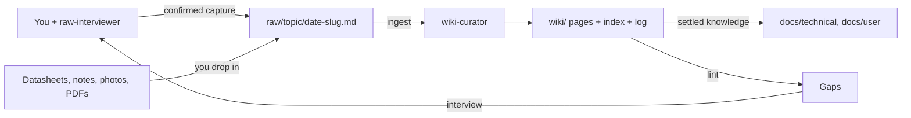

# Guide: working with the wiki personas

Four GitHub Copilot custom agents maintain and query this knowledge base (the OKF v0.2 bundle in [wiki/](wiki/index.md)). Their rules live in [AGENTS.md](AGENTS.md); this page is for you. The agents live in `.github/agents/` at the **repo root** (Copilot only finds them there), skills in `.github/skills/`.

| Persona | Does | Writes to |
|---------|------|-----------|
| **wiki-retriever** | Answers questions from the wiki (index first) with links and trust signals (draft/stable/deprecated, verified, stale). Says so when the wiki doesn't know. | `memory/` only |
| **raw-interviewer** | Interviews you one question at a time, checks the wiki first, plays back, saves a new raw file. | new files in `raw/` |
| **wiki-curator** | Ingests raw sources, answers and files syntheses, lints, runs the learning backlog. | `wiki/`, `memory/` (never `raw/`) |
| **wiki-unicorn** | All of the above; detects your intent per message and names the mode. | `wiki/`, `memory/`, new `raw/` files after your OK |

You may talk German or English; the wiki itself is English, `raw/` keeps your language.

## Invoke

From the repo root: `copilot --agent wiki-unicorn` (or `/agent` inside a session; also the agent picker in VS Code / the Copilot app). Specialists: `wiki-retriever` (read-only Q&A), `raw-interviewer` (focused interview), `wiki-curator` (batch ingest/lint).

## Workflow

1. **Capture**: describe a topic (bench type, sensors, formulas, decisions); say "das reicht" when done; confirm the playback.
2. **Ingest**: `ingest raw/<path>`; it updates 5-15 pages, indexes and log, and runs lint.
3. **Query**: ask; keep good answers as syntheses.
4. **Promote**: once something is settled, move it into `docs/technical/` (ADR, specs) or `docs/user/` (end-user guide).
5. **Lint**: `python docs/llm-wiki/tools/lint.py` (also in CI and pre-commit).

## Tips

- "Just make it work" -> the agent fixes it and offers a learning todo ([wiki/learning/](wiki/learning/index.md)).
- Paste URLs in an interview: they are downloaded into `raw/<topic>/` with `tools/fetch_raw.py`.
- Drafts vs. verified: only you verify ("I checked <page>, mark it verified").
- `raw/` is immutable: corrections go into a new raw file.
- Memory (`memory/`) holds agent working notes; edit freely.
- Obsidian: open `docs/llm-wiki` as a vault.
